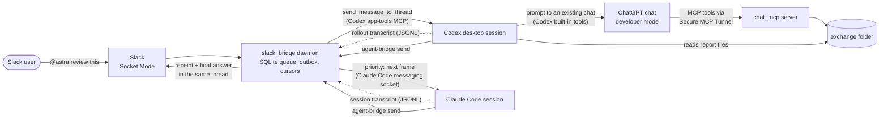

# agent-chat-bridge

A Slack front door for AI coding agents that are already running on your
machine: type `@astra` or `@fable` in a channel and the message is delivered
into an existing Claude Code or Codex session, with the agent's final answer
posted back to the thread. A companion MCP server gives an ordinary ChatGPT
chat sandboxed read/write access to one local folder, so local agents and
ChatGPT can hand each other prompts and reports as files.

## Components

| Directory | What it is | Size |
| --- | --- | --- |
| [`slack_bridge/`](slack_bridge/README.md) | Socket Mode Slack daemon, SQLite queue and outbox, delivery adapters for Codex desktop and Claude Code sessions, transcript receipt reader, Slack Home tab and `/agents` manager, agent-to-agent `send` | ~1,400 lines of Python, 55 tests |
| [`chat_mcp/`](chat_mcp/README.md) | MCP server (official Python SDK) exposing five file tools over stdio or loopback HTTP, confined to one root directory | ~210 lines of Python, 13 tests |
| `bin/agent-bridge` | Launcher: `run`/`send`/`status` go to the daemon, `list`/`add`/`edit`/`pause`/`resume`/`remove`/`discover` to the local manager | |

## Architecture



1. A Slack message starting with registered aliases is persisted, then
   acknowledged, then queued once per recipient.
2. The delivery loop checks the recipient is reachable and sends one message
   per agent at a time. The prompt carries a `BRIDGE_REPLY <id>` line for the
   agent's answer and links `slack_bridge/AGENT_GUIDE.md`.
3. The reply loop tails each agent's transcript. A native inbound record for
   the exact session marks the message `received`; a final answer with the
   marker marks it `complete` and goes to the Slack outbox.
4. Agents can message each other (`agent-bridge send`); peer messages are
   mirrored to the thread and labeled as carrying no user authority.
5. For ChatGPT work, a Codex agent writes a prompt file into the exchange
   folder and messages an existing ChatGPT chat with Codex's own
   `send_message_to_thread` tool. The chat, with `chat_mcp` connected through
   OpenAI's Secure MCP Tunnel, reads the prompt and writes its report plus a
   `completion.json` back into the folder. That prompt-submission step is a
   Codex desktop feature, not code in this repository.

## Setup

Requirements: Linux or WSL2 (the bridge uses `/proc`, `SO_PEERCRED`, `fcntl`),
Python 3.11+, systemd user services, the Codex desktop app and/or Claude Code
with the sessions you want to register.

```bash
git clone <this repo> ~/agent-chat-bridge && cd ~/agent-chat-bridge
python3 -m venv .venv
.venv/bin/pip install -r requirements.lock      # or requirements-dev.txt
.venv/bin/python -m pytest
ln -s "$PWD/bin/agent-bridge" ~/.local/bin/agent-bridge
```

### Slack app

1. Create a Slack app from [`slack_bridge/slack-manifest.yaml`](slack_bridge/slack-manifest.yaml)
   (Socket Mode, Home tab, interactivity, `/agents`, scopes
   `app_mentions:read chat:write channels:history groups:history commands`).
   Socket Mode means no public request URL is needed.
2. Install it to the workspace; create an app-level token with
   `connections:write`.
3. Put both tokens in `~/.config/agent-bridge/slack.env` and `chmod 600` it
   (see [`.env.example`](.env.example)).
4. Invite the bot to the channel you will use.

### Configure agents

```bash
mkdir -p ~/.config/agent-bridge
cp slack_bridge/config.example.json ~/.config/agent-bridge/config.json
# fill team, bot, users, channels, origin_thread; then replace the examples:
agent-bridge discover
agent-bridge add reviewer --session codex:SESSION_ID
```

Or use **Add agent** in the Slack Home tab. Under WSL with the Windows Codex
app, set `CODEX_SESSIONS_DIR=/mnt/c/Users/<you>/.codex/sessions`. All paths
and their environment overrides are listed in
[`slack_bridge/README.md`](slack_bridge/README.md#configuration).

### Run as a user service

```bash
cp slack_bridge/agent-bridge.service ~/.config/systemd/user/   # edit paths if not ~/agent-chat-bridge
systemctl --user daemon-reload
systemctl --user enable --now agent-bridge.service
agent-bridge status
```

### MCP server for ChatGPT or local clients

```bash
mkdir -p exchange
.venv/bin/python chat_mcp/server.py --root "$PWD/exchange"      # stdio
```

Local MCP clients: adapt [`chat_mcp/mcp-client.example.json`](chat_mcp/mcp-client.example.json).
ChatGPT: run the server behind OpenAI's `tunnel-client` stdio profile and add
the tunnel as a developer-mode connection; step-by-step in
[`chat_mcp/README.md`](chat_mcp/README.md#connect-an-ordinary-chatgpt-chat).

## Security model

This is a single-user tool for one person's own machine and Slack workspace.

- **Who can drive agents.** Only Slack events from the configured workspace,
  owner user IDs and channel IDs are accepted; bot posts and edits are
  ignored. The Home tab and `/agents` are owner-only. Anyone who controls the
  owner's Slack account can send instructions to the registered agents,
  which then act with whatever permissions those sessions already have.
- **No new authority.** The bridge does not change agent permission modes or
  approve tool calls. Peer agent messages are labeled "no new user
  authorization" in the envelope; that label is advisory text to the model,
  not an enforcement mechanism.
- **Secrets.** Slack tokens live in a 0600 file read per API call; they are
  not put in the service environment and are stripped from the environment
  of the Codex subprocess. Slack interaction `response_url`s are only
  followed over HTTPS to `slack.com` / `slack-gov.com`, without redirects.
- **Local trust.** Delivery targets are identified by exact session ID; the
  Claude Code socket owner PID is verified with `SO_PEERCRED`; receipts are
  only accepted from native transcript records for the exact session and
  registration, not from quoted text or compaction summaries. Any process
  running as your user can still read the queue database and transcripts.
- **MCP server.** stdio by default. The HTTP transport binds to `127.0.0.1`
  and has **no authentication**; never expose it publicly. For ChatGPT, use
  the authenticated Secure MCP Tunnel with the stdio transport. Whoever
  controls a chat with the connector enabled can read and overwrite anything
  under the root (overwrites are hash-checked and backed up). Files in the
  folder are model input: treat them as possible prompt injection.
- **Sandbox root.** Relative paths only; `..`, absolute paths, `.git`,
  `.history`, symlinks and multiply hard-linked files are rejected; each
  component is opened with `O_NOFOLLOW` from a root directory descriptor;
  8 MiB per file; no execution tool.

## Limitations

- Relies on internal, undocumented desktop interfaces: the Codex desktop
  app's bundled app-tools MCP server (found by scanning `/proc`) and Claude
  Code's session registry and messaging socket (verified against Claude Code
  2.1.280). Updates to either app can break delivery; failures are reported,
  not hidden.
- Linux/WSL only; tested on WSL2 with the Windows Codex desktop app. macOS,
  machine reboots and application upgrades are not validated.
- Reply routing needs the agent to emit the `BRIDGE_REPLY` line. Without it
  the message is reported as delivered without a reply; nothing is
  forwarded.
- No exactly-once guarantee across Slack network failures or external
  runtimes; uncertain sends are flagged rather than retried.
- The bridge cannot start missing sessions, and the ChatGPT side cannot
  create new chats: each destination chat must exist with the connector
  enabled and its model chosen in ChatGPT.
- `.history` backups in the exchange folder grow without pruning.
- Slack custom slash commands do not run inside threads.

## Tests

```bash
.venv/bin/python -m pytest          # 68 passed (55 slack_bridge, 13 chat_mcp)
```

No test touches Slack, OpenAI or the network: Slack calls and desktop
adapters are mocked, transcripts are temporary files, and the MCP tests start
the real server as a subprocess on stdio and on a random loopback port.

See [`docs/VALIDATION.md`](docs/VALIDATION.md) for what was validated against
the real services, and [`CHANGELOG.md`](CHANGELOG.md) for the development
history.

## License

MIT. See [`LICENSE`](LICENSE).
